


<a href="#sites"></a>
<a href="#about"></a>

<a href="#contact"></a>

Deutsch &nbsp;·&nbsp; Türkçe &nbsp;·&nbsp; English &nbsp;·&nbsp; فارسی &nbsp;&nbsp;|&nbsp;&nbsp; NRW, Germany &nbsp;&nbsp;|&nbsp;&nbsp; <a href="https://fyajan.com/">fyajan.com</a>



<a href="https://dawayar.pages.dev/"></a>
<a href="https://mini-dakhl.pages.dev/"></a>
<a href="https://shafa.pages.dev/"></a>
<a href="https://nuskha.pages.dev/"></a>
<a href="https://naqsha-zamin.pages.dev/"></a>
<a href="https://fy-netstore.pages.dev/"></a>



<a href="https://github.com/Ferhat-Yasinoglu/pusula"></a>

<a href="https://sosyal-studyo.pages.dev/"></a>
<a href="https://github.com/Ferhat-Yasinoglu/ferhat-yasinoglu/tree/main/botflow-mcp"></a>
<a href="https://github.com/Ferhat-Yasinoglu/ferhat-yasinoglu/tree/main/kazi"></a>


<a href="https://fyajan.com/"></a>

<a href="https://ferhat-yasinoglu.github.io/acik-defter/"></a>
<a href="https://github.com/Ferhat-Yasinoglu/ferhat-yasinoglu/blob/main/.github/scripts/cards.mjs"></a>

<b>What these projects taught me</b>

 

| Project | Learned here |
|---|---|
| Pusula | quota-aware failover across providers · stacked prompt compression · keeping a rebranded 16k-file fork consistent under one name |
| Dawayar | deriving stock and balances from documents instead of counters · last-writer-wins sync over a server sequence · rotating nonces to catch a cloned session |
| FY Merkez | one licence server for many products · trials and one-device rules · Shamsi dates and right-to-left in a panel |
| botflow-mcp | the Model Context Protocol · resumable background jobs · migrating a schema in place |
| kazi | robots.txt and redirects done right · an SSRF guard · PDFs page by page |
| Açık Defter | RTL through logical CSS properties · cache strategies · measuring contrast and touch targets in a real browser |
| NetStore | Firestore security rules · App Check · why an allowlist has no business in the client |
| This profile | animated SVG without scripts · subsetting fonts per card · committing only what changed |




<a href="https://www.typescriptlang.org/" title="TypeScript"></a>
<a href="https://developer.mozilla.org/tr/docs/Web/HTML" title="HTML5"></a>
<a href="https://developer.mozilla.org/tr/docs/Web/CSS" title="CSS"></a>
<a href="https://www.python.org/" title="Python"></a>
<a href="https://nodejs.org/" title="Node.js"></a>
<a href="https://nextjs.org/" title="Next.js"></a>
<a href="https://react.dev/" title="React"></a>
<a href="https://www.electronjs.org/" title="Electron"></a>
<a href="https://web.dev/explore/progressive-web-apps" title="PWA"></a>

<a href="https://developers.cloudflare.com/workers/" title="Workers"></a>
<a href="https://www.sqlite.org/" title="SQLite"></a>
<a href="https://modelcontextprotocol.io/" title="MCP"></a>
<a href="https://docs.anthropic.com/" title="Claude API"></a>

<a href="https://leafletjs.com/" title="Leaflet"></a>
<a href="https://vitest.dev/" title="Vitest"></a>
<a href="https://git-scm.com/" title="Git"></a>




<picture>
  <source media="(prefers-color-scheme: dark)" srcset="https://raw.githubusercontent.com/Ferhat-Yasinoglu/ferhat-yasinoglu/output/github-snake-dark.svg" />
  <source media="(prefers-color-scheme: light)" srcset="https://raw.githubusercontent.com/Ferhat-Yasinoglu/ferhat-yasinoglu/output/github-snake.svg" />
  
</picture>


